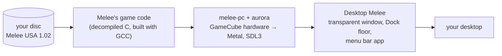

# Desktop Melee

Super Smash Bros. Melee on your Mac's desktop. The fighters stand on top of
the Dock, the screen edges are the blastzones, and your apps keep working
underneath. Set up the match from the menu bar, plug in a controller, and
play.


**You need your own Melee disc image (USA 1.02). No game data is included.**
Desktop Melee is a fan project. It is not affiliated with or endorsed by
Nintendo or HAL Laboratory.

## What it is

- **The real game.** It runs Melee's own code, built from the community
  decompilation, so movement, hitboxes and knockback are exactly Melee's. It
  is not an emulator.
- **A see-through overlay.** One transparent, click-through window covers the
  screen. Only the fighters, effects and HUD are drawn.
- **Your desktop is the stage.** Final Destination's floor is stretched to the
  width of your Dock, the screen edges are the blastzones, and stocks and
  percents sit in a black "island" around the MacBook notch.
- **A menu bar app.** Pick characters and costumes (with Melee's own
  portraits and announcer), CPU levels, controller ports, button maps, tap
  jump, fighter size, HUD placement and more.
- **Pause and hide.** One shortcut (⌃⌥M by default) pauses the match and
  hides the fighters, for when someone walks by.

## How it works, in one picture



The full explanation, layer by layer, with diagrams: **[How Desktop Melee
works](docs/desktop-melee/how-it-works.md)**. It covers decompilation versus
emulation, how the window becomes see-through, the math that maps your screen
into Melee's world, the menu bar app, and every file.

## Requirements

- A Mac. Tested on Apple silicon with macOS 27; older macOS versions and
  Intel Macs are untested. The Light/Dark app icon needs macOS 26 or later.
- Xcode (for Swift, `actool` and the macOS SDK) and these
  [Homebrew](https://brew.sh) packages:
  `brew install gcc cmake ninja sdl3 zstd libpng freetype`. GCC is required:
  the game code uses a GCC-only feature (see
  [how it works](docs/desktop-melee/how-it-works.md#41-big-endian-data-read-for-free)).
- Your own Super Smash Bros. Melee disc image: **USA, revision 2 (1.02),
  unmodified** (`.iso`, `.ciso` or `.rvz`). Desktop Melee checks it on first
  launch and refuses other versions.
- A controller is recommended: an official GameCube controller with a USB
  adapter, or any gamepad macOS supports. The keyboard works too.

## Build and run

```sh
git clone https://github.com/Mwrnk/desktop-melee.git
cd desktop-melee
pet/package.sh
```

`pet/package.sh` builds everything, makes `Desktop Melee.app`, signs it and
installs it in `/Applications` (set `DESKTOP_MELEE_INSTALL=0` to keep it in
`build/macos`). The first build downloads dependencies and takes a while.

Open **Desktop Melee** from `/Applications`. On first launch the welcome
window asks for your disc, checks it, has you press a button on each
controller, and shows how to play. Then click the stage icon in the menu bar
and press **Start**, or press Start on a controller.

To run it from a terminal with the log visible:

```sh
pet/run-overlay.sh path/to/melee.iso
```

### Permissions

- **Accessibility (optional):** lets Desktop Melee read the Dock's exact size
  and position, so the floor matches it to the point. Without it, the Dock's
  width is estimated from its settings. It is used for nothing else.
- **No network access.** Desktop Melee itself makes no network requests. It
  doesn't use melee-pc's online play or updater.

## Project layout

| Path | What |
|---|---|
| `pet/` | Desktop Melee: overlay, game mode, menu bar app, packaging. |
| `src/melee/`, `src/sysdolphin/` | Melee's decompiled game code (from doldecomp/melee). |
| `src/pc/` | melee-pc's platform layer. |
| `extern/aurora/` | aurora: GameCube SDK → WebGPU/SDL3. |
| `docs/desktop-melee/` | Desktop Melee's documentation. |
| `MELEE-PC.md` | melee-pc's own README: the port Desktop Melee is built on. |

## Before you share anything

- **Never share a built app.** `pet/package.sh` copies Melee's font from your
  disc into the app so the welcome window can use it. A built
  `Desktop Melee.app` (or a zip of it) therefore contains Nintendo's data. Share
  the source; everyone builds their own.
- **Never commit game data:** no disc images, no extracted textures, no
  `MELEE_PET_DUMP` output.
- **Bug reports:** don't attach or link disc images.

## Legal

This is not legal advice.

- **Game code (`src/melee/`, `src/sysdolphin/`) is not licensed.** It is a
  decompilation of a Nintendo game, from
  [doldecomp/melee](https://github.com/doldecomp/melee). Neither this project
  nor melee-pc can grant a license to it. This is the same position as
  doldecomp and melee-pc.
- **Port code and Desktop Melee (`src/pc/`, `pet/`, tools, build files) are
  GPL-3.0-or-later.** Third-party parts keep their own licenses (MIT, zlib,
  BSD, OFL).
- No game assets are in this repository. Everything is read from your disc
  at runtime.
- "Super Smash Bros." and "Melee" are trademarks of Nintendo.

The details are in [licenses/LICENSE.md](licenses/LICENSE.md).

## Credits

Desktop Melee stands on the work of:

- [doldecomp/melee](https://github.com/doldecomp/melee): the decompilation
  of Melee.
- [melee-pc](https://github.com/999sian/melee-pc): the native PC port that
  Desktop Melee is a fork of. Its README is kept as [MELEE-PC.md](MELEE-PC.md).
- [aurora](https://github.com/encounter/aurora): the GameCube SDK
  compatibility layer on WebGPU and SDL3.
- [Dawn](https://dawn.googlesource.com/dawn), [SDL3](https://libsdl.org),
  [nod](https://github.com/encounter/nod) and
  [RmlUi](https://github.com/mikke89/RmlUi).

## Status

Works: two-player VS matches (human or CPU) on the Dock, every character and
costume, the menu bar app, the welcome window, the notch island and
Pause and hide. You can pick which screen it plays on, but that has only been
tested with one screen.

Not yet: window tops as platforms you can drop through, more than two
players, other stages, operating systems other than macOS.
