# How Desktop Melee works

Desktop Melee runs the real Super Smash Bros. Melee on your Mac's desktop. The
fighters stand on top of the Dock, the screen edges are the blastzones, and
the rest of the screen stays usable. This page explains every layer, from the
GameCube disc to the transparent window, and why each piece is built the way
it is.

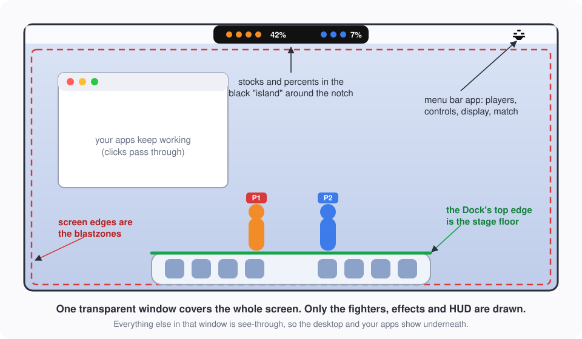

Contents:

1. [The big picture: four layers](#1-the-big-picture-four-layers)
2. [Decompilation, recompilation, emulation](#2-decompilation-recompilation-emulation)
3. [Layer 1: your disc](#3-layer-1-your-disc)
4. [Layer 2: the game code](#4-layer-2-the-game-code)
5. [Layer 3: melee-pc and aurora](#5-layer-3-melee-pc-and-aurora)
6. [Layer 4: Desktop Melee](#6-layer-4-desktop-melee)
7. [One frame, start to finish](#7-one-frame-start-to-finish)
8. [Making the window see-through](#8-making-the-window-see-through)
9. [Mapping the desktop into Melee's world](#9-mapping-the-desktop-into-melees-world)
10. [Stocks and percents in the notch island](#10-stocks-and-percents-in-the-notch-island)
11. [The game mode: idle, match, idle](#11-the-game-mode-idle-match-idle)
12. [The menu bar app](#12-the-menu-bar-app)
13. [Characters and sounds from your disc](#13-characters-and-sounds-from-your-disc)
14. [The disc check and the welcome window](#14-the-disc-check-and-the-welcome-window)
15. [Controllers and keyboard](#15-controllers-and-keyboard)
16. [Settings and where they live](#16-settings-and-where-they-live)
17. [Building and packaging](#17-building-and-packaging)
18. [Testing and debugging](#18-testing-and-debugging)
19. [Where Desktop Melee touches melee-pc](#where-desktop-melee-touches-melee-pc)
20. [File map](#20-file-map)
21. [Glossary](#21-glossary)

---

## 1. The big picture: four layers

Desktop Melee is the top of a stack. Each layer only talks to the one below
it.

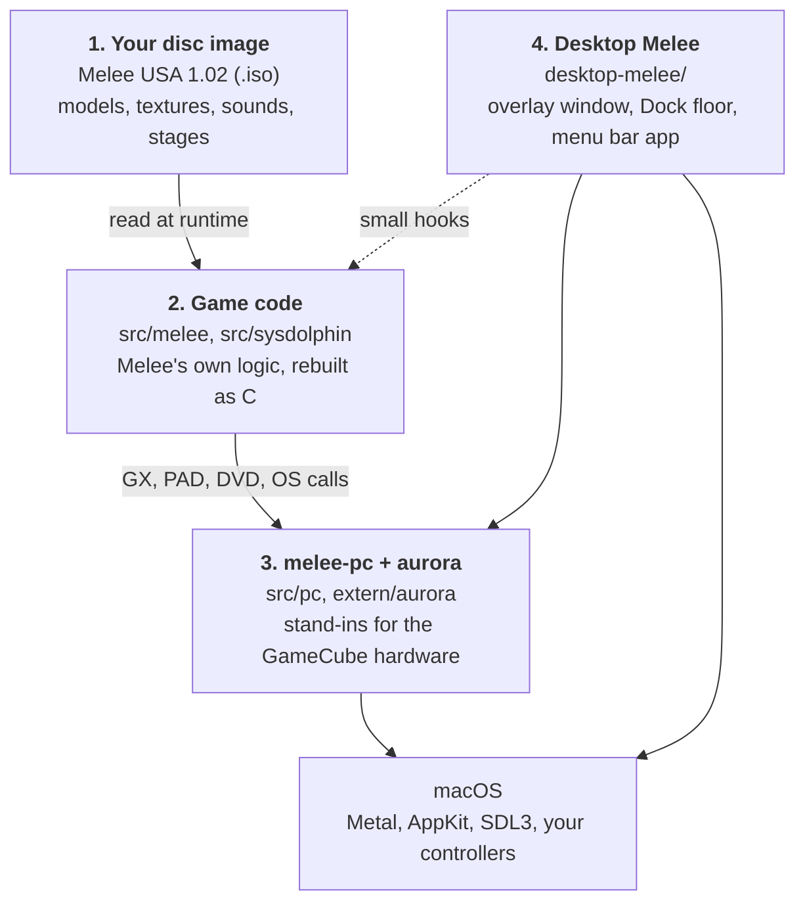

| Layer | Where | Who wrote it | What it does |
|---|---|---|---|
| 1. Disc | your own `.iso` | Nintendo / HAL | All the game's data: fighters, stages, sounds, text. Never stored in this repo. |
| 2. Game code | `src/melee/`, `src/sysdolphin/` | [doldecomp/melee](https://github.com/doldecomp/melee), adapted by melee-pc | Melee's logic: physics, hitboxes, fighters, menus, rules. |
| 3. Platform | `src/pc/`, `extern/aurora/` | [melee-pc](https://github.com/999sian/melee-pc), [aurora](https://github.com/encounter/aurora) | Replaces the GameCube's graphics chip, disc drive, controllers and OS with PC equivalents. |
| 4. Desktop Melee | `desktop-melee/` (+ marked hooks) | this project | Turns a full-screen game into a desktop overlay with a menu bar app. |

**Why this works well:** the game logic is Melee's own, frame for frame. No
part of the fighting is re-imagined: wavedashes, hitstun, ledge grabs and
knockback behave exactly like on a GameCube, because the same code runs.
Desktop Melee only changes *where* things are drawn and *what the stage is*,
never how the game plays.

---

## 2. Decompilation, recompilation, emulation

These three words get mixed up. Desktop Melee uses the first one.

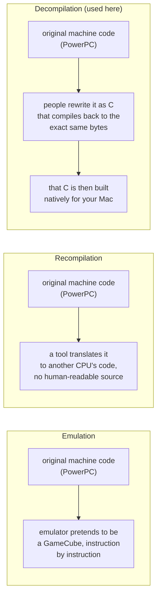

| | Emulation | Static recompilation | Decompilation |
|---|---|---|---|
| Input | The original program | The original program | The original program |
| Output | Nothing new; it runs the original | Translated machine code | Readable C source code |
| Runs as | A virtual GameCube | Native code, but opaque | Native code you can read and change |
| Can you add a desktop overlay? | Only from the outside | Very hard | Yes: change the C and rebuild |

**Decompilation, step by step:**

1. The [doldecomp/melee](https://github.com/doldecomp/melee) project takes the
   game's PowerPC machine code from the disc.
2. Contributors write C functions by hand, one at a time, until Nintendo's
   original compiler (Metrowerks CodeWarrior) turns each one back into the
   *exact same bytes*. That "matching" proves the C means exactly what the
   original code meant.
3. melee-pc takes that C and adapts it to a 64-bit PC (section 4).
4. GCC compiles it into a normal Mac program. There is no emulator: your Mac's
   CPU runs Melee's logic directly.

**What stays on the disc:** the decompilation is only the *code*. Every model,
texture, animation, sound and stage still comes from your own disc image at
runtime. That is why you need one.

---

## 3. Layer 1: your disc

- **Supported image:** Melee USA, revision 2 (NTSC-U 1.02, game id `GALE01`),
  unmodified. Desktop Melee checks it before booting
  ([section 14](#14-the-disc-check-and-the-welcome-window)).
- **Read through nod:** aurora opens the image with
  [nod](https://github.com/encounter/nod), so `.iso`, `.ciso` and `.rvz` all
  work. Raw images are memory-mapped.
- **Loaded verbatim:** archive files (`.dat`, `.usd`) are copied into memory
  byte for byte, still in the GameCube's big-endian byte order. The game code
  reads them in place (next section).

---

## 4. Layer 2: the game code

`src/melee/` (Melee itself) and `src/sysdolphin/` (HAL's engine, "HSD") are
the decompiled C, at the upstream commit in `src/UPSTREAM_COMMIT`. melee-pc
adapted it to run on a 64-bit, little-endian machine. Three tricks make that
possible.

### 4.1 Big-endian data, read for free

The GameCube is big-endian (most significant byte first); Macs are
little-endian. Instead of converting every file after loading, melee-pc marks
each structure that describes disc data with `DISC_STRUCT`:

```c
#define DISC_STRUCT __attribute__((scalar_storage_order("big-endian")))
```

GCC then swaps the bytes of every field *when it is read or written*. The
data stays exactly as it was on the disc, and the game code reads it as if
nothing changed (`src/pc/disc.h`).

**Why GCC:** this attribute exists only in GCC. Clang does not implement it,
so `tools/gcc_launcher.py` compiles the game code (`melee_game`) with
Homebrew's GCC, while everything else (melee-pc, aurora, Desktop Melee's
Objective-C and Swift) uses Apple's Clang. Both produce Mach-O objects that
link together.

### 4.2 32-bit pointers on a 64-bit machine

Disc files contain 32-bit pointers. On a 64-bit Mac a pointer is 8 bytes. So
disc pointer fields are typed `DISC_PTR(T)` (a 32-bit slot) and read through
`DP(T, slot)`, which turns the slot into a real address.

For that to work, the GameCube's 24 MB of main memory (MEM1) is mapped where
the low 32 bits of the address are `0x80000000`, the GameCube's own address.
A pointer cut down to 32 bits is still the GameCube address, and `DP()`
restores the rest (`extern/aurora/lib/dolphin/os/OSMemory.cpp`).

### 4.3 Marked divergences

Every place where melee-pc had to change the decompiled code is tagged
`/* PORT: ... */`, and every Desktop Melee hook is tagged `desktop-melee` inside
`#ifdef TARGET_PC`. The rest is the decompiled code as it is. The long list
of 64-bit bug classes (8-byte pointers, signed `char` on ARM, `bool`
clamping, missing `GXEnd`) is in [porting-notes.md](../melee-pc/porting-notes.md).

---

## 5. Layer 3: melee-pc and aurora

The game code was written for GameCube hardware. It calls the Dolphin SDK
(Nintendo's GameCube library): `GX` for graphics, `PAD` for controllers,
`DVD` for the disc drive, `AX` for audio, `OS` for threads and interrupts.
aurora and melee-pc provide all of those on a PC.

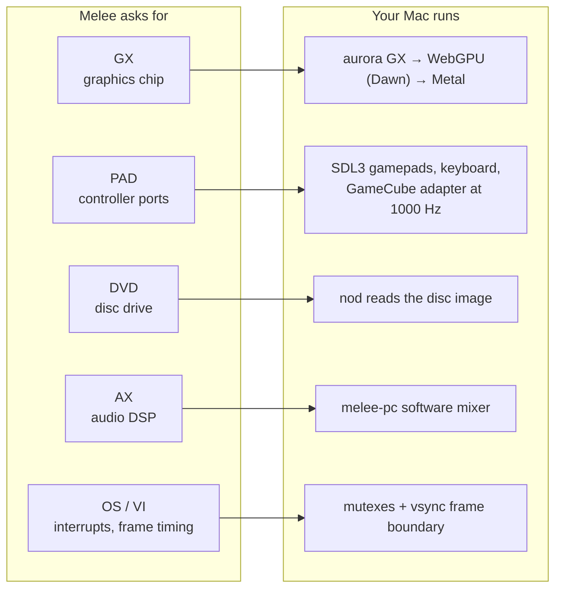

- **Graphics:** the game sends GX commands as if to the GameCube's graphics
  chip. aurora records them, compiles the GameCube's TEV color-combiner setups
  into WebGPU shaders, and draws them with Dawn on Metal. Compiled pipelines
  are cached in SQLite so the second run does not stutter.
- **Frame timing:** Melee is single-threaded. `VIWaitForRetrace` in
  `src/pc/vi.c` is the frame boundary, 60 times a second.
- **Interrupts:** the game protects shared state with
  `OSDisableInterrupts`/`OSRestoreInterrupts`. melee-pc maps those onto a
  recursive mutex, because aurora delivers "draw done" and "disc read done"
  callbacks on worker threads.
- **Input:** keyboard and touch are sampled at 1000 Hz on their own thread.
  An official GameCube controller adapter is read raw at 1000 Hz too.

More: [architecture.md](../melee-pc/architecture.md) (threads, memory map) and the
[melee-pc README](../../MELEE-PC.md).

---

## 6. Layer 4: Desktop Melee

Desktop Melee is about 7,000 lines in `desktop-melee/`, plus small marked hooks in
upstream files. It is turned on by one environment variable,
`DESKTOP_MELEE_OVERLAY=1`, which the app bundle always sets (`LSEnvironment` in
`desktop-melee/macos/Info.plist`). Without it, the same binary is plain melee-pc.

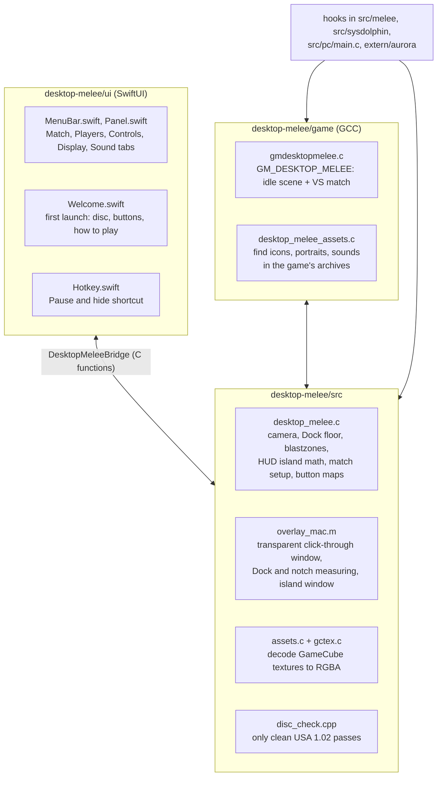

What each hook changes, in one line:

| Hook (file) | Change |
|---|---|
| `src/pc/main.c` | Overlay window settings, native disc picker; the overlay stays transparent until the game starts. |
| `src/pc/launcher.cpp` | melee-pc's launcher still waits for the shaders, but is never shown and can't be skipped; no update check. |
| `src/melee/gm/gmboot.c` | Boot straight into `GM_DESKTOP_MELEE`, never the title screen. |
| `src/sysdolphin/baselib/displayfunc.c` | "Clear the screen" clears to transparent, not black. |
| `src/melee/gr/grdisplay.c`, `src/melee/gr/ground.c` | Don't draw the stage or background models. |
| `src/melee/cm/camera.c` | Fixed desktop camera instead of Melee's zooming one. |
| `src/melee/mp/mplib.c` | Stretch Final Destination's floor to the Dock's width. |
| `src/melee/gr/ground.c` | Blastzones = the screen edges. |
| `src/melee/if/ifstock.c`, `src/melee/if/ifstatus.c`, `src/melee/if/ifall.c` | Stocks and percents into the notch island, the bottom, or hidden. |
| `src/melee/if/iftime.c` | Timer at half size at the top, or hidden. |
| `src/melee/if/ifnametag.c` | P1/P2/CPU tags always on, or off. |
| `src/melee/ft/fighter.c` | Per-player button remapping. |
| `src/melee/ft/kinds/ftCommon/ftCo_Jump*.c` | Tap jump on or off per player. |
| `src/melee/gm/gmvs.c`, `src/melee/gm/gmscdata.c`, `src/melee/gm/forward.h` | Register `GM_DESKTOP_MELEE`, restart a running match. |
| `extern/aurora/` (several files) | Transparent, borderless, always-on-top window; coverage alpha; premultiplied presentation. |

---

## 7. One frame, start to finish

Everything below happens 60 times a second on the main thread, except the GPU
work aurora hands to its render worker.

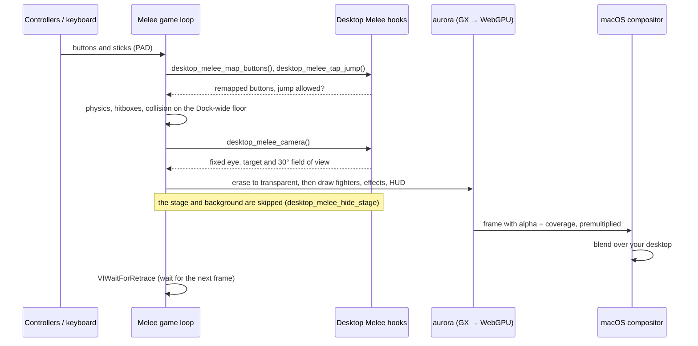

---

## 8. Making the window see-through

A game window is normally opaque. Desktop Melee needs every pixel the game
doesn't draw to be clear, and every click to pass through to the apps
underneath. That takes a chain of changes, and a single broken link makes the
whole screen black or blocks your mouse.

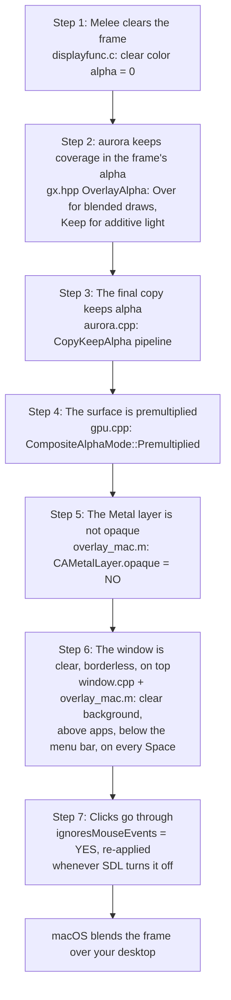

Details that matter:

- **Coverage, not color, in alpha.** The GameCube's frame buffer is usually
  RGB with no alpha. aurora uses the unused alpha channel to record "how much
  was drawn here". A blended draw adds coverage (`a = srcA + dstA·(1 − srcA)`);
  additive effects such as light flashes leave it alone, so glows brighten the
  desktop instead of painting black boxes.
- **Premultiplied alpha** is what macOS expects from a see-through layer:
  color already multiplied by alpha. Straight alpha would show dark fringes
  around every fighter.
- **The click-through guard.** SDL turns `ignoresMouseEvents` off whenever a
  transparent window gets a mouse-moved event (`updateIgnoreMouseState` in
  SDL's `SDL_cocoawindow.m`). A full-screen window that takes clicks, above
  every app, would lock you out of your own Mac. `DesktopMeleeClickThroughGuard` in
  `desktop-melee/src/overlay_mac.m` watches that property and turns it back on at once.
- **Window level.** The overlay sits at `NSMainMenuWindowLevel - 1`: above
  every app window, below the menu bar, so the menu bar app and the notch
  island stay on top. It joins all Spaces, so it follows you between
  desktops.
- **Pause and hide** fades the window to alpha 0 but keeps it drawing, so the
  game loop never stalls on a hidden window, and pauses the match with
  Melee's own pause.

---

## 9. Mapping the desktop into Melee's world

Melee measures everything in its own units. Final Destination's blastzones
are 490 units apart. Desktop Melee picks a mapping so that the screen *is*
the stage.

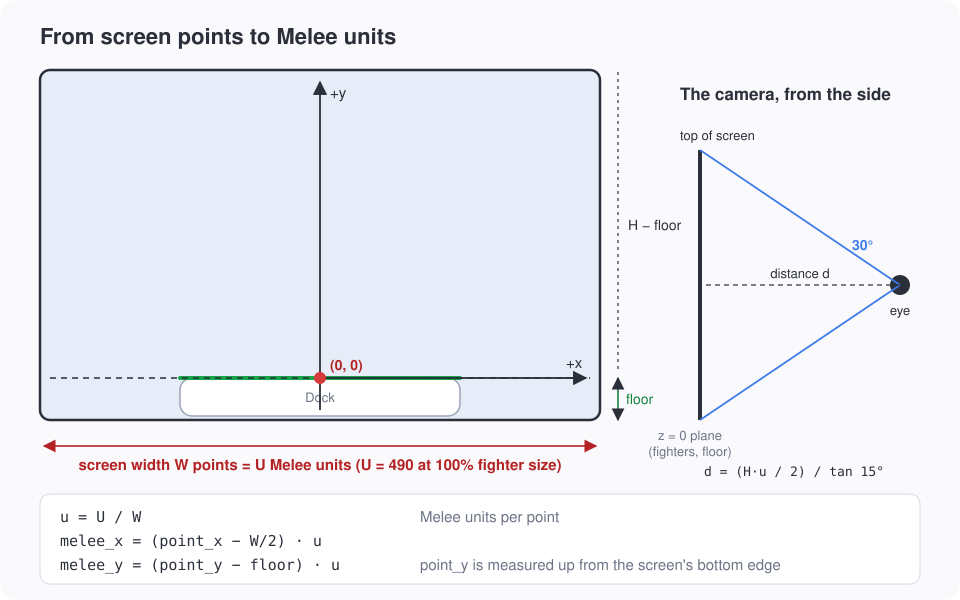

### 9.1 The rule

- **x = 0** is the middle of the screen.
- **y = 0** is the top of the Dock (the floor).
- The screen is **U** Melee units wide. U = 490 at 100% fighter size, the
  same width as Final Destination's blastzones, so fighters look the size
  they would on a TV. The Display tab's size control sets
  `U = 490 × 100 / size%`: at 200% the screen is 245 units wide and the
  fighters look twice as big.

So with `u = U / W` (Melee units per point, W = screen width in points):

```text
melee_x = (point_x − W/2) · u
melee_y = (point_y − floor) · u      point_y measured up from the bottom
```

### 9.2 The camera

Melee's own camera zooms and pans to follow the fighters. On a desktop that
would make the fighters drift away from the Dock, so `desktop_melee_camera()` in
`desktop-melee/src/desktop_melee.c` replaces it with a fixed one:

- It looks straight down the −z axis at the screen's center.
- Field of view: 30°, narrow, so the z = 0 plane (where fighters and the
  floor live) maps almost linearly onto the screen, while depth effects such
  as a Star KO still shrink into the distance.
- Distance: `d = (H·u / 2) / tan 15°`, which makes the visible height exactly
  the screen's height in Melee units.
- Screen shake is Melee's own quake offset, added to the camera unless you
  turn it off in the Display tab.

### 9.3 The floor: Final Destination, stretched

A match always uses Final Destination: one flat floor, no platforms, no
hazards. When the stage's collision loads, `src/melee/mp/mplib.c` stretches
it horizontally so the floor spans the Dock exactly:

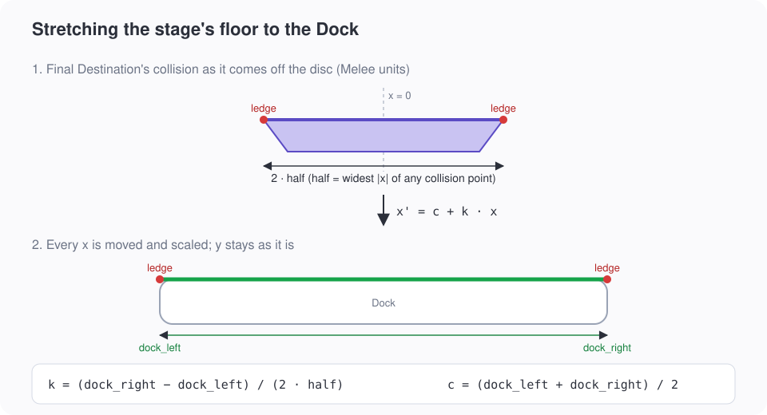

- `half` is the widest |x| of any collision point of the stage.
- Every collision x becomes `c + k·x`, with `k = (dock_right − dock_left) / (2·half)`
  and `c = (dock_left + dock_right) / 2`. y is untouched.
- The ledges sit at the floor's corners, so they move with it: you can grab
  the Dock's edges.

**Measuring the Dock** (`desktop-melee/src/overlay_mac.m`):

| Accessibility permission | Dock width | Floor height |
|---|---|---|
| Granted | Exact, from the Dock's on-screen list element (`AXUIElement`) | Exact top of the Dock |
| Not granted | Estimated from the Dock's settings: icon size and icon count | Bottom of the screen's visible area |

With no Dock on the overlay's screen, Final Destination keeps its own width.

### 9.4 Blastzones

`desktop_melee_blastzones()` makes the screen edges the blastzones (`src/melee/gr/ground.c`):

```text
left   = −U / 2              right  = +U / 2
top    = (H − floor) · u     bottom = −floor · u
```

Fly off any edge of your screen and you lose a stock.

### 9.5 What "latched" means

The camera, the floor and the blastzones all depend on the screen and the
fighter size. Changing them mid-match would teleport the floor under the
fighters. So the size and the HUD placement are *latched* when a match starts
(`desktop_melee_match_began`), and screen or Dock changes wait until the match ends.

---

## 10. Stocks and percents in the notch island

On a MacBook with a notch, Desktop Melee draws a black "island" window around
the notch and moves Melee's own stock icons and damage percents into it, P1
on the left, P2 on the right.

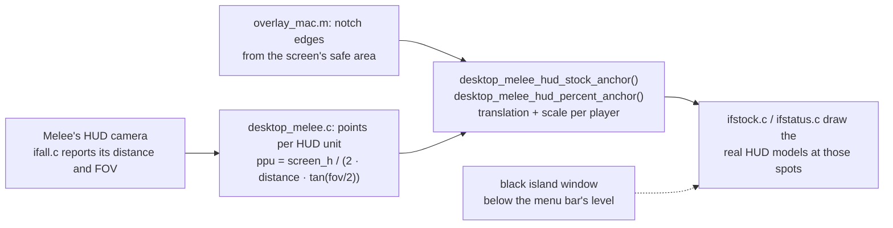

- The island is sized from the menu bar height: padding, four stock icons,
  a gap, and room for a three-digit percent with its `%` sign
  (`ISLAND_*` constants in `desktop-melee/src/desktop_melee.c`).
- These are Melee's actual HUD models, moved and scaled, not redrawn
  copies, so damage colors and stock animations stay authentic.
- The island only shows while the HUD is actually rendering (checked every
  250 ms), so it vanishes between matches.
- On a screen without a notch the island is centered in the menu bar strip.
- The Display tab can instead keep Melee's HUD at the bottom of the screen, or
  hide it.

---

## 11. The game mode: idle, match, idle

Melee organizes everything into *game modes* (Classic, VS, Training...) made
of *scenes*. Desktop Melee adds its own mode, `GM_DESKTOP_MELEE`
(`desktop-melee/game/gmdesktopmelee.c`), and the overlay boots straight into it.

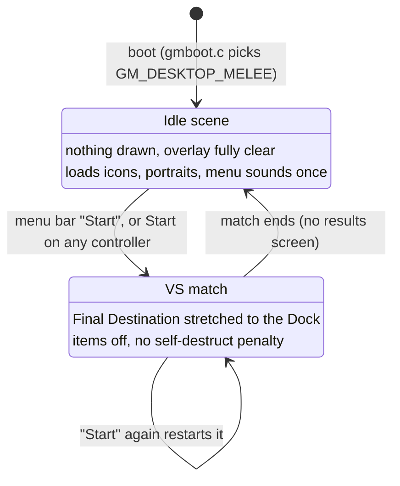

When a match starts (`onEnterVs`), the setup comes from the menu bar
(`DesktopMeleeMatchSetup` in `desktop-melee/src/desktop_melee_game.h`):

- Two players: character, costume, human or CPU, CPU level 1–9, and which
  controller port plays each human.
- Stocks (default 4) and time limit (default 7 minutes, 0 = none).
- Pausing goes through `check_for_pauser_override`, so Pause and hide can
  pause *as* the first human player: that player's Start resumes.

---

## 12. The menu bar app

The menu bar app is SwiftUI, compiled as a static library (`desktop_melee_ui`) and
linked **into the game binary**. There is one process and one main thread.

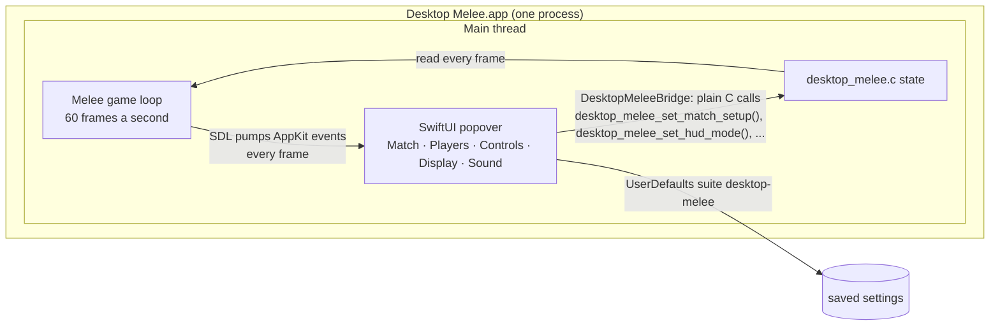

**Why one process:** the Swift code reads and writes the game's settings with
ordinary C function calls (`desktop-melee/ui/bridge/desktop_melee_bridge.h`, imported as the
`DesktopMeleeBridge` Swift module). There is no IPC, no locking and no latency: a
button remap made in the Controls tab applies on the very next frame.

**Why it stays responsive:** the game loop calls SDL's event pump every frame,
and that pump also runs AppKit's run loop, so SwiftUI gets its events between
frames.

**Accessory app:** the app is `LSUIElement` (no Dock icon, no app menu) and
SDL is told not to turn it into a regular app
(`SDL_HINT_MAC_BACKGROUND_APP`). It lives in the menu bar only.

The tabs:

| Tab | What it sets |
|---|---|
| Match | Stocks, time, Start/Restart, Pause and hide and its shortcut (default ⌃⌥M). |
| Players | Character, costume, human/CPU, CPU level, for P1 and P2. Real portraits and announcer callouts from your disc. |
| Controls | Controller port per player, tap jump, button map (A B X Y Z L R), shared UCF setting. |
| Display | Screen, fighter size (100–200%), stocks/percents placement, timer, tags, screen shake. |
| Sound | Master, music and effects volume (shared with melee-pc), menu sounds. |

**Pause and hide's shortcut** is a Carbon system hotkey (`RegisterEventHotKey`
in `desktop-melee/ui/Hotkey.swift`). It works while any app is in front and needs no
permission. The recorder only accepts combinations with at least two
modifiers, one of them Control, Option or Command, so it can never take an
everyday shortcut like ⌘C from every app.

---

## 13. Characters and sounds from your disc

The menu bar shows Melee's real character icons, portraits, font and menu
sounds. None of it is in this repository: it is read from your disc each
time the game boots.

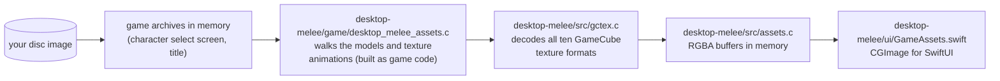

- **GameCube textures** are stored in tiles (8×8, 8×4 or 4×4 pixels),
  sometimes with a palette. `gctex.c` turns each format into plain RGBA:
  I4, I8, IA4, IA8, RGB565, RGB5A3, RGBA8, CI4, CI8 and CMPR (the GameCube's
  DXT1 variant, with big-endian colors).
- `desktop_melee_assets.c` is compiled with the game code because it walks the disc's
  structures, which need `DISC_STRUCT` and therefore GCC.
- Sounds (menu clicks, the announcer's character names) are played through
  the game's own sound engine.
- **Melee's font** is the one exception that leaves memory: it is saved to
  `~/Library/Application Support/Desktop Melee/melee-font.bin` on first boot,
  and `desktop-melee/package.sh` copies it into the app so the welcome window can use it
  before a disc is chosen. That makes a built app personal: never upload one.
- **Before any disc**, text uses `desktop-melee/macos/DesktopMelee.ttf`, a
  vector recreation of Melee's menu font that every build bundles (release
  builds too). `AppFont` in `GameAssets.swift` registers it; its em is one
  32-unit glyph cell, so it lines up with the disc's glyphs at the same size.

`DESKTOP_MELEE_DUMP=<dir>` writes every asset found to PNG files, to help find
assets. Never commit that output.

---

## 14. The disc check and the welcome window

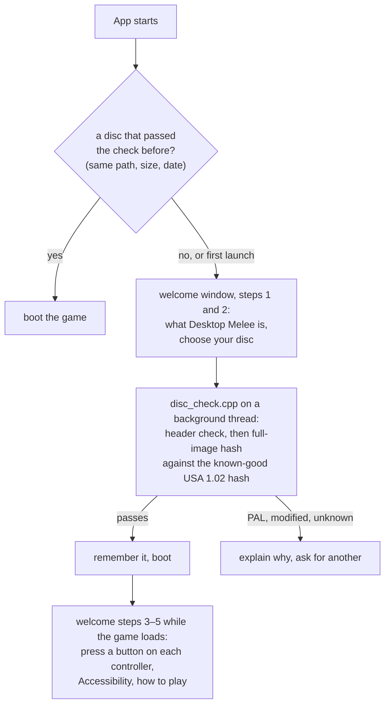

- Only a clean USA 1.02 image passes. melee-pc can run the European (PAL)
  image experimentally; Desktop Melee does not, so the game is always the
  version the decompilation matches.
- The hash runs once per file. After that the file's path, size and
  modification date are enough (`desktop-melee/ui/DiscMemory.swift`).
- Until a disc is in, the overlay window is hidden, so the welcome window
  never sits under an invisible full-screen window.

**Loading, and melee-pc's launcher.** Before the first match, melee-pc's
launcher builds every graphics pipeline it knows (about 6,600), so matches
never stutter. That takes about 5 minutes on the first launch and a few
seconds after that, because macOS caches the compiled shaders. Desktop Melee
keeps the launcher running for that wait but never shows it: the overlay stays
fully transparent until the game starts (`desktop_melee_launcher_wait_begin` /
`desktop_melee_launcher_wait_end` in `desktop-melee/src/desktop_melee.c`). `desktop-melee/ui/Loading.swift` shows the
progress instead:

- **First launch:** inside the welcome window's "Getting Melee ready…" screen,
  with a progress bar and the time left.
- **Later launches:** nothing, unless the rest of the work would take more
  than about 3 seconds at the current rate (after a new build or a macOS
  update). Then a small "Getting Melee ready…" window appears until the game
  starts.

---

## 15. Controllers and keyboard

- **Ports:** each human player picks a controller port in the Controls tab;
  `onEnterVs` sets that port as the player's slot.
- **Background input:** `allowJoystickBackgroundEvents` keeps controllers
  working while another app is in front, and `pauseOnFocusLost` is off, so the
  game never pauses because you clicked on your browser.
- **Keyboard:** melee-pc ignores keys unless the game window is the key
  window. Starting a match or un-hiding brings the overlay forward
  (`desktop_melee_ui_focus_game`) so keyboard play works; otherwise your keys would go
  to the app in front.
- **Button map:** `desktop_melee_map_buttons()` runs in the fighter's human-input
  branch (`src/melee/ft/fighter.c`) and rewrites the held buttons. A trigger
  remapped to another button stops giving an analog light shield.
- **Tap jump:** `desktop_melee_tap_jump()` is checked where a stick-up jump would start
  (`ftCo_Jump.c`, `ftCo_JumpAerial.c`, `ftCo_JumpAerialF1.c`). CPU players
  always keep it. The check uses the player's slot, so Nana follows her
  player's setting, the same as Popo.

---

## 16. Settings and where they live

| Where | What |
|---|---|
| `defaults read desktop-melee` (UserDefaults suite `desktop-melee`) | `players.pN.*`, `controls.pN.*`, `display.size`, `display.screen`, `display.hud`, `display.timer`, `display.tags`, `display.shake`, `match.stocks`, `match.minutes`, `match.pauseKey`, `sound.menu`, `onboarding.done`, `disc.verified` |
| `launcher.cfg` in melee-pc's preferences folder | Volumes, UCF and the other melee-pc settings, shared with the melee-pc launcher. |
| `~/Library/Application Support/Desktop Melee/` | `melee-font.bin` (section 13). |
| `~/Library/Logs/Desktop Melee.log` | The log, when the app starts without a terminal. |

Back up your settings with `defaults export desktop-melee backup.plist`; restore
with `defaults import desktop-melee backup.plist`.
Builds before the rename kept them in a `melee-pet` suite; the first launch
copies them into `desktop-melee` once (`desktop-melee/ui/Settings.swift`) and
leaves the old suite alone.

---

## 17. Building and packaging

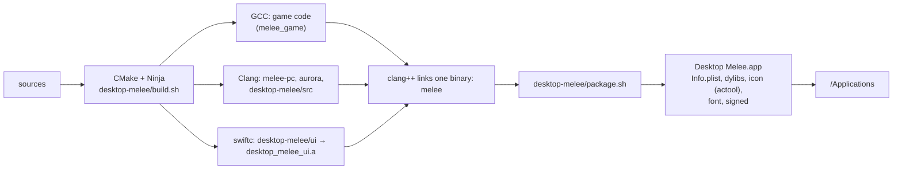

- `desktop-melee/build.sh` configures `build/macos` once and runs Ninja. Homebrew GCC
  is required for the game code.
- `desktop-melee/desktop-melee.cmake` adds Desktop Melee's sources and links SwiftUI, Combine,
  Carbon and AppKit. The binary links with `clang++`, not `swiftc`, so it
  points the linker at the Swift runtime explicitly.
- `desktop-melee/package.sh` builds through melee-pc's `tools/package_macos.sh`, swaps
  in `desktop-melee/macos/Info.plist`, compiles the app icon with `actool` (a beige Mac
  in Light Mode, an indigo one in Dark Mode), copies the font, signs, and
  installs.
- **Signing:** with an "Apple Development" certificate in your keychain the
  signature stays the same between builds, so the Accessibility permission
  survives rebuilds. Ad-hoc signing works too, but macOS asks again after
  every build.
- **Release builds:** `DESKTOP_MELEE_RELEASE=1 desktop-melee/package.sh` makes
  the app for the releases page: no font from your disc, a check that fails
  if any game file is inside, the license texts in `Contents/Resources/licenses`,
  ad-hoc signing (it isn't notarized, so players use "Open Anyway" once), no
  install, and a zip in `dist/`. It opens on the macOS it was built on and
  later.

---

## 18. Testing and debugging

`desktop-melee/tests/run_all.sh` runs every test (about 9 minutes). **The tests take
over your screen** (they launch the real overlay and play matches), and some
add and remove keys in the `desktop-melee` defaults suite; back it up first.

| Variable | Effect |
|---|---|
| `DESKTOP_MELEE_OVERLAY=1` | Overlay mode (the app bundle sets it). |
| `DESKTOP_MELEE_SCALE=<units>` | Melee units across the screen (50–5000), overriding the size setting. |
| `DESKTOP_MELEE_LOG=<file>` | `desktop-melee/run-overlay.sh`: where the log goes. |
| `DESKTOP_MELEE_TRACE=1` | Logs a `desktop-melee: trace` line every second during a match; SIGUSR1 presses Pause and hide. |
| `DESKTOP_MELEE_INPUT_TRACE=1` | Logs blocked tap jumps and remapped buttons. |
| `DESKTOP_MELEE_DUMP=<dir>` | Writes found assets and offscreen popover renders as PNGs. |
| `DESKTOP_MELEE_WELCOME=1` / `disc` | Opens the welcome window (on the disc step). |
| `MELEE_KEY_FIFO=<path>` | melee-pc: read key presses from a named pipe (tests drive matches with it). |
| `MELEE_BOOT_SCENE=<name>` | melee-pc: boot a specific scene instead of `GM_DESKTOP_MELEE`. |
| `MELEE_INPUT_TRACE=1` | melee-pc: log port 1's controller every frame. |
| `MELEE_LOG_FILE=<file>`, `MELEE_BACKEND=<name>` | melee-pc: log file, graphics backend. |

Useful log lines: `desktop-melee: screen`, `desktop-melee: Dock ... (exact|estimated)`,
`desktop-melee: floor`, `desktop-melee: blastzones`, `desktop-melee: match P1 ckind ...`, `boot scene:`.

---

## Where Desktop Melee touches melee-pc

Everything outside `desktop-melee/` that Desktop Melee changed is tagged `desktop-melee` in
a comment, usually inside `#ifdef TARGET_PC`. The full list, required by the
GPL for modified files, is in
[licenses/LICENSE.md](../../licenses/LICENSE.md#desktop-melee); the table in
[section 6](#6-layer-4-desktop-melee) says what each hook does. To see them
all:

```sh
git grep -n 'desktop-melee' -- src extern
```

---

## 20. File map

```text
desktop-melee/
├── build.sh                          configure + build (Homebrew GCC for game code)
├── package.sh                        build the .app, icon, sign, install
├── run-overlay.sh                    run the installed app with a log
├── desktop-melee.cmake               adds desktop-melee/ to the CMake build
├── src/
│   ├── desktop_melee.h               hooks main.c calls
│   ├── desktop_melee_game.h          hooks the game code calls
│   ├── desktop_melee.c               camera, floor, blastzones, island math, controls
│   ├── overlay_mac.m                 window, click-through, Dock/notch, island window
│   ├── assets.c, gctex.c             texture decoding for the menu bar
│   └── disc_check.cpp                USA 1.02 check (background thread)
├── game/
│   ├── gmdesktopmelee.c              GM_DESKTOP_MELEE: idle scene + VS match
│   └── desktop_melee_assets.c        finds icons/portraits/sounds in archives
├── ui/                               SwiftUI menu bar app (one file per tab)
│   ├── Settings.swift                the desktop-melee defaults suite
│   └── bridge/                       DesktopMeleeBridge: the C API Swift calls
├── macos/
│   ├── Info.plist                    bundle id, LSUIElement, DESKTOP_MELEE_OVERLAY=1
│   ├── AppIcon.icon/                 Icon Composer icon (light + dark, five layers each)
│   └── icon/                         icon SVG sources + render.sh
├── tests/                            screen-driving tests (they take over the screen)
└── tools/                            small helpers (disc check CLI, window list)
```

---

## 21. Glossary

| Term | Meaning |
|---|---|
| **Decompilation** | Rewriting machine code as source code. Here: C that compiles back to Melee's exact bytes. |
| **Matching** | A decompiled function is "matching" when the original compiler turns it into identical bytes. |
| **Recompilation** | Translating machine code straight to another CPU's machine code, without readable source. Not used here. |
| **Emulation** | Running the original machine code on a simulated console (Dolphin). Not used here. |
| **Dolphin SDK** | Nintendo's GameCube library (GX, PAD, DVD, OS, AX). No relation to the Dolphin emulator except the codename. |
| **GX** | The GameCube's graphics API; aurora turns it into WebGPU. |
| **TEV** | The GameCube's texture environment: its fixed-function color combiner, compiled to shaders by aurora. |
| **EFB** | Embedded frame buffer: where the GameCube draws a frame. |
| **HSD / sysdolphin** | HAL Laboratory's engine under Melee: objects, models, archives. |
| **Big-endian** | Most significant byte first: the GameCube's byte order. Macs are little-endian. |
| **`DISC_STRUCT`** | A GCC attribute that byte-swaps a struct's fields on access. |
| **MEM1** | The GameCube's 24 MB of main memory, mapped so its addresses survive in 32 bits. |
| **Melee unit** | Melee's distance unit; Final Destination's blastzones are 490 units apart. |
| **Blastzone** | The invisible boundary; crossing it loses a stock. Here: your screen edges. |
| **Coverage alpha** | How much of a pixel the game drew, kept in the alpha channel so the window can be see-through. |
| **Premultiplied alpha** | Color already multiplied by its alpha: what macOS needs for transparent layers. |
| **Notch island** | The black window around the MacBook notch that holds stocks and percents. |
| **`GM_DESKTOP_MELEE`** | Desktop Melee's game mode: an empty idle scene plus VS matches. |
| **Latched** | Fixed when a match starts and kept until it ends. |
| **Accessory app** | A macOS app with no Dock icon or app menu (`LSUIElement`). |
| **UCF** | Universal Controller Fix: a community fix for dashback and shield drop on worn sticks. |
